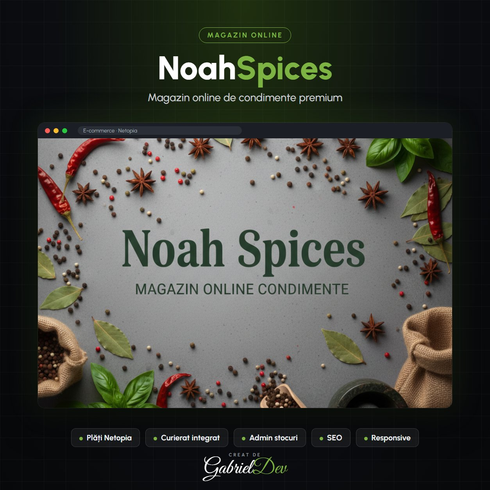

  

<h1 align="center">NoahSpices – Magazin Online de Condimente Premium</h1>

NoahSpices este o platformă de e-commerce modernă, concepută pentru a aduce aromele lumii direct în bucătăriile pasionaților de gastronomie. Proiectul a fost axat pe crearea unei experiențe de cumpărături fluide, punând accent pe rapiditate, securitate și un design vizual care să reflecte prospețimea produselor.

| | |
|---|---|
| **Client** | Client privat |
| **An** | 2026 |
| **Domeniu** | Backend Development · Frontend Development · Aplicații Web Personalizate |
| **Status** | Livrat (site-ul nu mai este online) |
| **Studiu de caz** | [gabrieldev.eu](https://gabrieldev.eu/portofoliu/magazin-online-noahspices) |

---

### Caracteristici Principale:

- **Arhitectură Personalizată:** Dezvoltarea unei structuri de rute optimizate pentru SEO și user-experience (ex: utilizarea segmentului /magazin/ pentru o mai bună indexare locală).
- **Sistem de Plăți Securizat:** Integrare completă cu procesatorul de plăți **Netopia**, asigurând tranzacții rapide și sigure pentru clienți.
- **Management de Conținut (CMS):** Panou de administrare intuitiv pentru gestionarea stocurilor, categoriilor de condimente și a comenzilor în timp real.
- **Design Responsive:** Interfață adaptată perfect pentru orice dispozitiv (Desktop, Tabletă, Mobil), facilitând procesul de achiziție din mers.
- **Performanță și Scalabilitate:** Optimizarea timpului de încărcare a paginilor și a bazei de date pentru a susține un trafic ridicat și căutări complexe de produse.

### Tehnologii Utilizate:

- **Frontend:** Interfață modernă axată pe conversie și estetică minimalistă.
- **Backend:** Logică robustă pentru procesarea comenzilor și securitatea datelor.
- **Integrări:** API-uri pentru plăți și servicii de curierat.

**Obiectiv:** Transformarea unei simple vizite într-o experiență senzorială digitală, unde calitatea produselor NoahSpices este susținută de o platformă tehnică de înaltă performanță.

Caracteristici Principale: Arhitectură Personalizată: Dezvoltarea unei structuri de rute optimizate pentru SEO și user-experience (ex: utilizarea segmentului /magazin/ pentru o mai bună indexare locală). Sistem de Plăți Securizat: Integrare completă cu procesatorul de plăți Netopia, asigurând tranzacții rapide și sigure pentru clienți. Management de Conținut (CMS): Panou de administrare intuitiv pentru gestionarea stocurilor, categoriilor de condimente și a comenzilor în timp real. Design Responsive: Interfață adaptată perfect pentru orice dispozitiv (Desktop, Tabletă, Mobil), facilitând procesul de achiziție din mers. Performanță și Scalabilitate: Optimizarea timpului de încărcare a paginilor și a bazei de date pentru a susține un trafic ridicat și căutări complexe de produse. Tehnologii Utilizate: Frontend: Interfață modernă axată pe conversie și estetică minimalistă. Backend: Logică robustă pentru procesarea comenzilor și securitatea datelor. Integrări: API-uri pentru plăți și servicii de curierat. Obiectiv: Transformarea unei simple vizite într-o experiență senzorială digitală, unde calitatea produselor NoahSpices este susținută de o platformă tehnică de înaltă performanță.

---

## 🔒 Despre cod

Acesta este un repository de **prezentare**. Codul sursă aparține clientului și nu este public — aici găsești descrierea proiectului, funcționalitățile și tehnologiile folosite.

## 🤝 Ai nevoie de ceva asemănător?

Proiect realizat de **[Gabriel Dev](https://gabrieldev.eu)** — creare site-uri, magazine online și aplicații web personalizate.

- 🌐 [gabrieldev.eu](https://gabrieldev.eu) · [toate proiectele](https://gabrieldev.eu/proiecte)
- ✉️ [contact@gabrieldev.eu](mailto:contact@gabrieldev.eu)
- 📞 [+40 743 543 100](tel:+40743543100)
